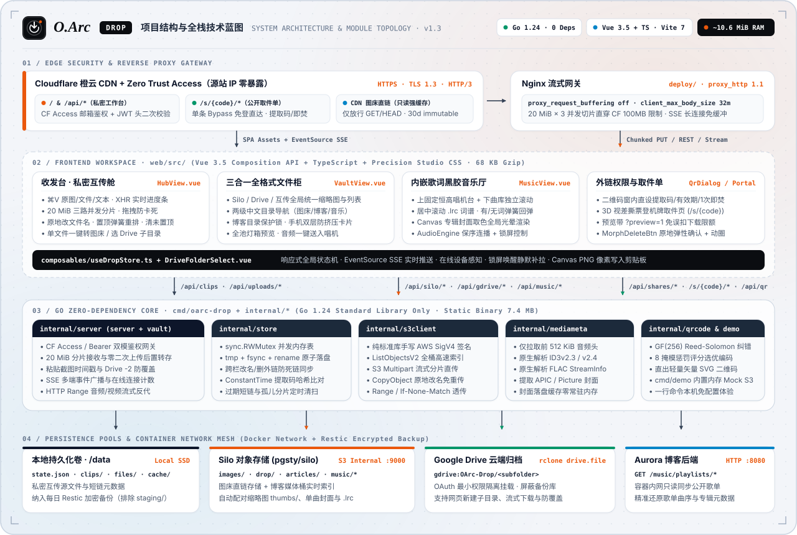

# O.Arc DROP

自托管低占用 **跨端无损私密互传台 · 单文件一键转图床 / Google Drive 归档 · 三合一全格式文件柜 · 内嵌歌词黑胶音乐厅**。  
后端采用 **Go 1.24 纯标准库零外部依赖** 单二进制（生产容器常驻内存仅 **`~3–10 MiB`**），前端采用 **Vue 3.5 + TypeScript** 冰晶白霜精工器材风（Precision Studio Hardware UI + 专辑封面实时取色光晕）。

<p align="center">
  
</p>

---

## 四栏核心结构

1. **收发台（Hub）**：
   - **以粘贴与文件为核心、默认私密互传**：全页仅保留单一粘贴/文件投递舱，按 `⌘V`（文件、无损原图、文字通吃）、点击「选择文件」或直接拖入任意体积文件（`≤ 20 MiB` 走 `XMLHttpRequest` 实时进度流，大文件自动 `20 MiB × 3` 并发切片直穿 Cloudflare 橙云 `100 MB` 单请求限制），全程带平滑进度条与旋转动圈。
   - **原地改名、一键清扫与单文件后置分流（零二次上传）**：点击文件名即可原地重命名（自动保留扩展名），支持置顶弹簧重排与一键清理未置顶项；每个已上传卡片自带 **「存图床拿外链」**（服务端内网直推 Silo `images/` 并自动复制 Markdown 链接）与 **「存 Drive ▾」子文件夹下拉框**（列出并支持新建隔离目录子文件夹，同名自动加 `-2` 防静默覆盖）。
   - **零浏览器原生弹窗**：全站删除、清扫与作废外链均采用原地弹性变形确认胶囊（Morph Confirm + 异步旋转动圈）。
2. **文件柜（Vault）**：
   - **三存储池全局统一显示样式**：右上角选定「缩略图画廊 / 信息列表」后，在 **Silo 对象存储 · Google Drive · 私密互传** 三个存储池保持一致的显示样式，切换存储池绝不跳变视图；手机端自适应双层防挤压卡片与双列缩略图网格。
   - **两级中文目录用途导航与文件夹增删**：Silo 按「全部 · 图床相关 · 博客相关（默认加锁防误删）· 音乐相关 · 其他目录」分级展开并标注目录用途；支持在 Silo（`.keep` 零字节占位）与 Google Drive 隔离目录内直接 **新建自定义子文件夹** 与 **安全删除文件夹**（非空目录自动提示文件数与体积确认，博客/音乐生产目录禁止误删）。
   - **跨容器任意具体目录复制/移动 & 多选批量操作**：支持单文件或开启 **「多选」** 批量勾选后，在 `Silo ↔ Google Drive ↔ 私密互传` 任意容器的具体文件夹（或当场新建子目录）之间服务端流式 **复制或移动**（同桶零拷贝 `CopyObject`、移动后自动更新已绑定短链不死链），以及一键 **批量删除**。
   - **iOS 桌面图标、灵动岛与主屏全屏（PWA Standalone）适配**：纯 Go 零外部资源合成 `180×180` / `512×512` 器材风桌面图标（经 `/assets/*` 免登录直出，iOS 添加到主屏幕不白屏），四向 `env(safe-area-inset-*)` 适配灵动岛与底部横条。
3. **音乐厅（Music）**：
   - **上半部恒高一体式唱机台 + 下半部曲库独立滚动**：黑胶唱盘、带微刻度尺的果冻进度条（拖动跟手预览、松手精准跳转）、主控键与 **内嵌居中滚动 `.lrc` 歌词窗** 融于同一面板；有词与纯音乐切换带弹簧回弹过渡，联动博客公开歌单保序连播与锁屏 MediaSession 控制。
4. **外链管理与公开取件单（Shares & `/s/{code}`）**：
   - 主站走 Cloudflare Access 零信任保护，单条 `/s/*` Bypass 规则放行 3D 视差撕票登机牌公开取件页；二维码弹窗内直接支持实时配置 **提取码、有效期（24 小时 / 7 天 / 长期）与下载次数上限（含 1 次阅后即焚）**，公开页内联预览（`?preview=1`）不误扣下载额度。

---

## 目录结构与技术对照

| 目录 / 文件 | 核心职责 | 关键技术实现 |
|---|---|---|
| [`cmd/oarc-drop/main.go`](cmd/oarc-drop/main.go) | 生产服务端入口 | 环境变量装配、优雅停机、10 分钟周期后台清扫协程 |
| [`cmd/demo/main.go`](cmd/demo/main.go) | 免配置本地演示入口 | 内置内存态 Mock Silo S3 + 示例 ID3v2 音频与 `.lrc` 词谱 |
| [`internal/server/`](internal/server) | HTTP / SSE 路由、跨池流转与桌面图标合成 | Go 1.22+ 标准路由、CF Access 鉴权、`20 MiB` 分片引擎、三存储池流式复制/移动、纯 Go 合成 `180/512px` PNG 图标 |
| [`internal/store/store.go`](internal/store/store.go) | 并发状态与短链存储 | `sync.RWMutex` + `tmp/fsync/rename` 原子持久化、`subtle.ConstantTimeCompare` 密码核验、跨池移动/删除防死链同步 |
| [`internal/s3client/s3.go`](internal/s3client/s3.go) | 纯标准库 S3 客户端 | 零 SDK 手写 AWS SigV4 签名、`ListObjectsV2`、S3 Multipart 流式分片直传、`CopyObject` |
| [`internal/mediameta/meta.go`](internal/mediameta/meta.go) | 流式音频头解析器 | 仅拉取前 `512 KiB` 解析 `ID3v2.3/v2.4` 与 `FLAC StreamInfo/Vorbis/Picture` 内嵌封面 |
| [`internal/qrcode/qr.go`](internal/qrcode/qr.go) | 零依赖二维码引擎 | 纯 Go 实现 `GF(256)` Reed-Solomon 纠错编码与 8 掩模评分，直出矢量 SVG |
| [`web/src/composables/useDropStore.ts`](web/src/composables/useDropStore.ts) | 前端全局响应式总线 | `EventSource` SSE 实时同步、文件夹增删与跨池流转 API、`XHR` 粘贴进度队列、Canvas 封面取色与 PNG 剪贴板写入 |
| [`web/src/components/`](web/src/components) | 四栏视图与精工交互组件 | `HubView` · `VaultView` · `VaultCopyModal` · `MusicView` · `AudioEngine` · `DriveFolderSelect` · `MorphDeleteBtn` · `QrDialog` · `PublicSharePortal` |
| [`deploy/docker-compose.yml`](deploy/docker-compose.yml) | 容器化编排 | 多阶段构建（Node 22 + Go 1.24 → Debian Slim + `rclone`），非 root 运行，`128 MiB` 内存硬上限 |

---

## 本地运行与测试

```bash
# 1. 前端 TypeScript 类型检查与生产构建
cd web && npm run check && cd ..

# 2. 后端单元与 14 步端到端集成测试（分片流式上传、Drive 防覆盖、阅后即焚、跨栏联动、二维码生成）
go test -v ./...

# 3. 本机一键启动内置演示环境（免外部 S3 / rclone 依赖）
go run ./cmd/demo
# 浏览器打开 http://127.0.0.1:8095
```

## 容器部署

1. 复制 [`.env.example`](.env.example) 为 `.env` 填入 S3 凭证（如需启用 Google Drive 归档，将 `drive.file` 权限的 `rclone.conf` 放入 `./secrets/rclone.conf`）；
2. 使用 [`deploy/docker-compose.yml`](deploy/docker-compose.yml) 构建启动，并在反向代理层关闭 `proxy_request_buffering` 以获得最佳流式切片吞吐。

---

## 发布记录

- **2026-11-19 v1.5.1（安卓 120Hz 高刷流畅度治理 · View Transitions 昼夜丝滑整屏淡入）**：
  - **安卓高刷屏（120Hz）渲染快路径**：移动端移除外层 `.macos-window` `blur(34px)` 与滚动列表 `.glass-box` `blur(20px)` 嵌套毛玻璃（改为 `96%` 实底 + 镜面描边与轻阴影），顶/底栏与抽屉遮罩降为轻量 `blur(12px)` / `blur(6px)`，去掉移动端全屏 `mix-blend-mode` 与高频点阵底图；长列表卡片加 `contain` 与 `content-visibility: auto` 跳过屏外重绘；唱盘独立 GPU 合成层；音乐厅进度条拖动全面改走纯 GPU `transform: scaleX()` / `translate3d()` + `requestAnimationFrame` 合帧并缓存矩形防回流。
  - **彻底消除昼夜切换黑白异步撕裂**：删除 `html, body` 慢速背景色渐变，切换主题时以 `html.theme-switching` 冻结所有散装过渡，并接入原生 View Transitions API（旧帧实底不动、新帧 220ms 柔和交叉淡入覆盖），彻底消除卡片与按钮各变各的割裂闪烁。
- **2026-11-19 v1.5.0（iPhone Air & 安卓手机端深度全栈适配）**：
  - **PWA 壳层、状态栏与安卓防裁切图标**：修复浅色模式下 iPhone Air 主屏 PWA 状态栏白字隐身（补齐首帧防闪白脚本与 `color-scheme` 同步），禁止数字自动识别为电话链接；后端新增免登录 `/assets/icon-192.png` 与带 80% 安全区的 `/assets/icon-512-maskable.png`（适配安卓圆形/水滴自适应图标）；补齐 `interactive-widget=resizes-content`。
  - **软键盘避让与原生级触屏体验**：新增 `useMobileViewport` 监听 `visualViewport`，软键盘弹出时自动隐藏底栏、迷你播放器与多选坞，并向底部抽屉注入 iOS `--kb-inset` 防遮挡输入框；横屏（含 iPhone Air `912×420pt`）统一走移动端紧凑布局；校准底栏指示条偏移、增加角标/在线状态点与点击回顶；去除触屏灰块闪动、隔离桌面 `:hover` 防粘滞、弹窗锁定底层滚动防穿透。
  - **iOS 剪贴板、系统原生分享与页面全量扫雷**：修复 iOS Safari「复制原图」因异步脱离手势必报错（同步传入 `ClipboardItem` Promise）及剪贴板回退误弹键盘；分享弹窗与外链管理接入 Web Share API 一键调起系统分享；文件柜手机端双列网格去遮挡、预览升级为全功能底部抽屉（含分享码、重命名、删除闭环）；音乐厅精简手机顶栏、搜歌弹键盘自动折叠唱盘、加大进度条热区并支持歌词窗展开/收起、补齐锁屏 `MediaSession` 进度同步与拖拽；收发台两行上传进度条、重命名保存/取消按钮、视频 `playsinline` 与 PDF 新窗打开；修复公开取件页 `/s/{code}` 的 SHA-256 在窄屏撑破横向滚动条并关闭触屏 3D 卡斜。
- **2026-11-19 v1.4.0（iOS 桌面图标与灵动岛全屏适配 · 文件夹增删 · 跨容器复制/移动与多选批量管理）**：
  - **手机桌面图标、灵动岛与主屏全屏适配**：纯 Go 实时合成 `180×180`（iPhone `@3x` 主屏幕圆角安全区全出血）与 `512×512` 器材风应用图标及 `manifest.webmanifest`，挂载于 `/assets/*` 免登录直出以兼容 Cloudflare Access 下的 iOS「添加到主屏幕」抓取；补齐 `apple-mobile-web-app-capable`、随深浅主题切换的状态栏底色与四向 `env(safe-area-inset-*)` 灵动岛避让。
  - **修复手机端无法新建 Google Drive 子目录**：定位并修复 iOS Safari 软键盘弹出触发全局 `resize` / `scroll` 导致下拉框闪退关闭的问题，移动端改为上半屏安全定位与 `16px` 防自动缩放输入框。
  - **Silo 与 Google Drive 文件夹增删**：支持在文件柜内直接新建 Silo 目录（写入 `.keep` 标记持久化空文件夹）与 Drive 子目录，并支持安全删除自定义目录（非空目录返回 `409` 提示文件数量与体积二次确认，博客与音乐生产目录返回 `403` 防误删）。
  - **跨容器具体文件夹复制/移动与多选批量操作**：新增 `POST /api/vault/copy` 与 `VaultCopyModal`，支持将单文件或多选批量文件在 `Silo ↔ Google Drive ↔ 私密互传` 任意具体子目录间服务端直转（Silo 同桶走 `CopyObject` 零拷贝、Drive 同盘走 `rclone copyto/moveto`、移动后自动同步短链引用）；文件柜新增「多选」模式与底部悬浮批量操作坞（支持全选、批量复制、批量移动与批量删除进度展示）。
- **2026-11-19 v1.3.0（文件柜两级中文导航与统一视图 · 粘贴实时进度与动圈 · 手机端与跨页死链全量修复）**：
  - **文件柜体验重做**：三个存储池（Silo / Google Drive / 私密互传）全局统一「缩略图网格 / 列表」显示样式，切换存储池不再跳变视图，顶部筛选与说明栏随存储池平滑联动；Silo 新增「图床相关 / 博客相关 / 音乐相关」两级中文目录说明导航与卡片用途标注，Google Drive 补齐子目录筛选与灯箱预览，音频支持一键送入唱机。
  - **全链路进度与旋转动圈**：`20 MiB` 以内快速粘贴改走 `XMLHttpRequest` 实时进度队列；所有删除、作废外链、转存图床、转存/新建 Google Drive 目录均补齐防连点旋转动圈。
  - **分享与收发台增强**：二维码弹窗内直接支持实时配置提取码、有效期与下载次数上限（含 1 次阅后即焚）；收发台支持点击文件名原地改名、一键清理未置顶项、置顶弹簧重排、锁屏唤醒自动补拉与在线设备感知。
  - **硬伤与移动端修复**：修复连贴 `image.png` 重名及转存 Google Drive 静默覆盖（自动加时间戳与 `-2` 后缀）、公开取件页预览与 `HEAD` 请求误扣下载上限、外链作废与文件柜改名删除跨页 404 死链、Silo 大文件改走 S3 Multipart 流式分片及孤儿 `staging/` 清扫、歌单播放乱序、进度条拖动抽搐与双音轨混响；修复手机端列表窄屏竖排挤压与按钮重叠、iOS Safari `sticky` 顶栏滚丢、底栏缝隙穿帮与幽灵 CSS 变量。
- **2026-11-19 v1.2.0（收发台单文件后置分流 · 内嵌居中歌词唱机 · 精工器材风重设计）**：
  - 「收发台」重构为单一粘贴/文件投递舱 + 单文件一键转存 Silo 图床与 Google Drive 子目录下拉框；全站移除原生 `window.confirm()`；「音乐厅」改为恒高唱机 + 内嵌居中歌词窗。
- **2026-11-18 v1.1.1（全量歌曲封面入库配对 · 音乐厅独立滚动）**：
  - 全量歌曲与歌单封面镜像入库自动配对，重构上下分栏独立滚动曲库。
- **2026-11-18 v1.1.0（四栏工作台重做与图床/歌单联动）**：
  - 合并精简为四栏结构，内置零依赖 SVG 二维码与博客歌单同步。
- **2026-11-18 v1.0.0**：
  - 首版发布（Go 零依赖服务端 + Vue 3 前端 + Cloudflare Access 接入）。
